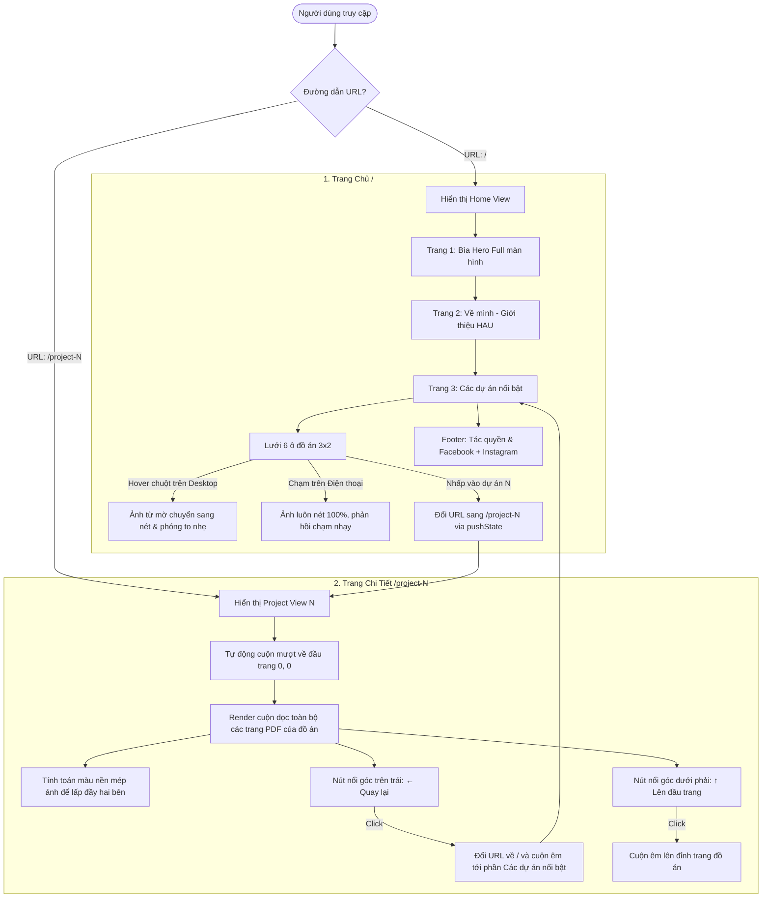

# TÀI LIỆU TOÀN DIỆN LUỒNG HOẠT ĐỘNG & KIẾN TRÚC DỰ ÁN
## Trần Phương Diễm — Graphic Design Portfolio (HAU 2023 - 2027)

> **Cập nhật lần cuối:** 23/10/2026  
> **Trạng thái:** Production Ready — Deploy tự động trên Vercel via GitHub `main`  
> **Website:** [https://diem-portfolio.vercel.app](https://diem-portfolio.vercel.app)

---

## 1. TỔNG QUAN DỰ ÁN & TRIẾT LÝ THIẾT KẾ

Portfolio cá nhân của **Trần Phương Diễm**, sinh viên chuyên ngành Thiết kế Đồ họa (Graphic Design) khóa 2023 - 2027, **Trường Đại học Kiến trúc Hà Nội (HAU)**.

### Triết lý cốt lõi:
1. **Tôn trọng 100% bản vẽ gốc:** Toàn bộ nội dung đồ họa được chuyển giao từ bản thiết kế portfolio chuẩn khổ **A3 ngang** (57 trang PDF), không đưa vào các khung mockup giả lập gò bó, không chèn header/footer dày cộm chiếm diện tích.
2. **Mỗi trang thiết kế là một màn hình trọn vẹn:** 
   - Trên Desktop: Mỗi trang PDF chiếm trọn vẹn màn hình (`100vh`), hiển thị sắc nét tỉ lệ gốc. Hai bên mép ảnh tự động được tô màu nền đồng nhất nhờ thuật toán lấy mẫu màu pixel thực tế, tạo cảm giác vô cực liền mạch.
   - Trên Điện thoại / Thiết bị cảm ứng: Tự động co giãn theo chiều ngang 100%, chiều cao tỷ lệ thuận, các trang cuộn nối tiếp nhau dính sát, không có khoảng cách thừa.
3. **Định tuyến SPA mượt mà:** Chuyển đổi giữa trang chủ `/` và từng đồ án `/project-1`, `/project-2`, ..., `/project-6` không tải lại trang, đổi URL trực tiếp hỗ trợ nút Back/Forward của trình duyệt.

---

## 2. KIẾN TRÚC THƯ MỤC DỰ ÁN

```text
Diem-Portfolio/
├── index.html                   # Khung HTML gốc chứa 2 View (Home & Project Detail)
├── main.js                      # Logic Router, render động, lấy màu nền ảnh, sự kiện
├── style.css                    # File CSS tổng hợp (import các module con)
├── vercel.json                  # Cấu hình Vercel SPA rewrites (chống lỗi 404 route /project-N)
├── package.json                 # Cấu hình Vite, dependencies, build scripts
├── scratch-convert-pdf.py       # Script Python tối ưu chuyển đổi 57 trang PDF thành WebP siêu nhẹ
│
├── styles/                      # Thư mục module CSS tách biệt dễ chỉnh sửa
│   ├── base.css                 # Reset mặc định, ẩn hiện, cấu trúc cơ sở
│   ├── home.css                 # Giao diện Trang chủ: Lưới 6 ô đồ án, tiêu đề, footer mạng xã hội
│   └── project.css              # Giao diện Trang chi tiết: Khổ trang .page, nút nổi quay lại & lên đầu
│
├── public/
│   ├── assets/
│   │   ├── avt.webp             # Ảnh đại diện tác giả
│   │   ├── pages/               # Trang bìa & Trang giới thiệu trích xuất từ PDF
│   │   │   ├── hero.webp        # Trang 1 PDF (Bìa Hero)
│   │   │   └── about.webp       # Trang 2 PDF (About me & Kỹ năng)
│   │   └── projects/            # Thư mục ảnh bản vẽ của 6 đồ án (tổng 55 trang)
│   │       ├── project-01/      # YÊU NƯỚC (cover, cover-thumb, page-01..12.webp)
│   │       ├── project-02/      # REPEET (cover, cover-thumb, page-01..08.webp)
│   │       ├── project-03/      # DÂN HOA GIÁP VIỆT (cover, cover-thumb, page-01..07.webp)
│   │       ├── project-04/      # STAR KOMBUCHA (cover, cover-thumb, page-01..10.webp)
│   │       ├── project-05/      # GIẾT CON CHIM NHẠI (cover, cover-thumb, page-01..03.webp)
│   │       └── project-06/      # Ô Ớ À (cover, cover-thumb, page-01..15.webp)
│   │
│   └── data/
│       └── projects.json        # Dữ liệu JSON chuẩn hoá 6 đồ án (tiêu đề, phân loại, đường dẫn ảnh)
│
└── docs/                        # Tài liệu hướng dẫn & kỹ thuật
    └── PROJECT_FLOW_DOCUMENTATION.md
```

---

## 3. SƠ ĐỒ LUỒNG HOẠT ĐỘNG (USER FLOW & ROUTING)



---

## 4. CÁC ĐỒ ÁN TIÊU BIỂU TRONG HỆ THỐNG

| TT | Mã Route | Tên Đồ Án | Thể loại | Số trang bản vẽ | Thư mục dữ liệu |
|---|---|---|---|:---:|---|
| 01 | `/project-1` | **THIẾT KẾ HỆ THỐNG BAO BÌ QUÀ TẶNG "YÊU NƯỚC"** | Packaging & Structural Design | 12 trang | `public/assets/projects/project-01/` |
| 02 | `/project-2` | **THIẾT KẾ HỆ THỐNG BAO BÌ BỀN VỮNG "REPEET"** | Packaging & Sustainable Design | 8 trang | `public/assets/projects/project-02/` |
| 03 | `/project-3` | **THIẾT KẾ BỘ LỊCH VĂN HÓA "DÂN HOA GIÁP VIỆT"** | Publication & Gift Design | 7 trang | `public/assets/projects/project-03/` |
| 04 | `/project-4` | **THIẾT KẾ NHẬN DIỆN THƯƠNG HIỆU "STAR KOMBUCHA"** | Brand Identity & Packaging | 10 trang | `public/assets/projects/project-04/` |
| 05 | `/project-5` | **THIẾT KẾ BÌA & BẢN TRÌNH BÀY SÁCH "GIẾT CON CHIM NHẠI"** | Book Cover & Editorial Design | 3 trang | `public/assets/projects/project-05/` |
| 06 | `/project-6` | **THIẾT KẾ SỰ KIỆN TRIỂN LÃM TƯƠNG TÁC "Ô Ớ À"** | Exhibition & Interactive Space | 15 trang | `public/assets/projects/project-06/` |

---

## 5. CÁC GIẢI PHÁP KỸ THUẬT ĐẶC TRƯNG

### 5.1. Xử lý tỉ lệ A3 ngang trên màn hình Desktop 16:9 (`tintPage`)
- **Vấn đề:** Khổ A3 ngang có tỉ lệ $\approx 1.41 : 1$, trong khi màn hình máy tính phổ thông là $16:9 \approx 1.78 : 1$. Nếu ép tràn chiều ngang thì chiều cao sẽ vượt quá 100vh và bị cắt; nếu giữ trong 100vh thì hai bên mép sẽ bị hở viền trắng.
- **Giải pháp:** Sử dụng canvas ẩn 1px để đọc màu của pixel mép trên-trái của từng ảnh (`ctx.drawImage(img, 0, 0, 4, 4, 0, 0, 1, 1)`), sau đó tự động gán màu này làm `background` cho phần tử `.page` bọc ngoài.
- **Kết quả:** Hai bên viền tiệp màu 100% với nền ảnh thiết kế gốc của Diễm, tạo trải nghiệm thị giác tràn viền hoàn hảo.

### 5.2. Tối ưu trải nghiệm cuộn trên Điện thoại (Mobile Responsive)
- **Vấn đề:** Màn hình điện thoại có tỷ lệ dọc ($9:16$). Nếu để `height: 100vh`, ảnh A3 ngang bị teo nhỏ lại ở giữa màn hình và tạo ra 2 khoảng trống rất lớn ở trên và dưới.
- **Giải pháp CSS:**
  ```css
  @media (max-width: 768px), (orientation: portrait) {
    html { scroll-snap-type: none; }
    .page { height: auto; display: block; }
    .page img { width: 100%; max-height: none; }
  }
  ```
- **Kết quả:** Các trang PDF nối tiếp nhau liền mạch như một trang cuộn dài tự nhiên, không bị hở bất kỳ khoảng trống thừa nào.

### 5.3. Xử lý tương tác cảm ứng vs Con trỏ chuột
- Hiệu ứng mờ (`filter: blur(3px)`) và làm rõ khi hover (`filter: none; transform: scale(1.06)`) được bọc cẩn thận trong media query:
  ```css
  @media (hover: hover) and (pointer: fine) {
    /* Chỉ áp dụng cho máy tính có chuột */
    .project-thumb img { filter: blur(3px) grayscale(15%); opacity: 0.7; }
    .project-card:hover img { filter: none; opacity: 1; transform: scale(1.06); }
  }
  ```
- Trên điện thoại/iPad: Toàn bộ ảnh các dự án **luôn nét 100%**, người dùng nhìn rõ ngay nội dung mà không cảm thấy mờ mắt khó chịu.

### 5.4. Định tuyến SPA không tải lại trang & Chống lỗi 404 trên Vercel
- JavaScript sử dụng HTML5 History API: `history.pushState(null, '', url)` kết hợp sự kiện `popstate`.
- Khi người dùng gõ trực tiếp URL `https://diem-portfolio.vercel.app/project-1` hoặc F5 làm mới, Vercel sử dụng cấu hình rewrite trong `vercel.json`:
  ```json
  {
    "framework": "vite",
    "cleanUrls": true,
    "rewrites": [
      { "source": "/(.*)", "destination": "/index.html" }
    ]
  }
  ```
  Nhờ đó, server luôn trả về `index.html` để router phía client tự nhận diện `location.pathname` và hiển thị đồ án chuẩn xác ngay lập tức.

---

## 6. HƯỚNG DẪN BẢO TRÌ & CẬP NHẬT DỰ ÁN

### 6.1. Chạy thử nghiệm ở máy cục bộ (Local Development)
```bash
# Cài đặt thư viện nếu chưa có
npm install

# Khởi động máy chủ phát triển
npm run dev
# Mở trình duyệt tại http://localhost:5173/
```

### 6.2. Thêm hoặc Chỉnh sửa thông tin một Đồ án
Mở file [projects.json](file:///g:/Project/Diem-Portfolio/public/data/projects.json):
- Sửa tiêu đề tại trường `"title"`.
- Sửa mô tả tại trường `"description"` hoặc `"summary"`.
- Thêm đường dẫn trang ảnh vào mảng `"pages"`.
- Thêm ảnh mới vào thư mục tương ứng trong `public/assets/projects/project-XX/`.

### 6.3. Chỉnh sửa giao diện theo file CSS module
- Muốn chỉnh màu sắc, reset hoặc nút bấm: mở [styles/base.css](file:///g:/Project/Diem-Portfolio/styles/base.css) hoặc [styles/project.css](file:///g:/Project/Diem-Portfolio/styles/project.css).
- Muốn chỉnh lưới chọn đồ án hoặc footer mạng xã hội: mở [styles/home.css](file:///g:/Project/Diem-Portfolio/styles/home.css).

### 6.4. Đưa thay đổi lên bản trực tiếp (Deploy Production)
Chỉ cần thực hiện commit và push lên nhánh `main` của GitHub:
```bash
git add .
git commit -m "Cập nhật nội dung..."
git push origin main
```
Hệ thống Vercel đã kết nối với kho lưu trữ [liliustwocout/Diem-Portfolio](https://github.com/liliustwocout/Diem-Portfolio) sẽ tự động kích hoạt tiến trình Build và cập nhật trang web sau 30-60 giây.
